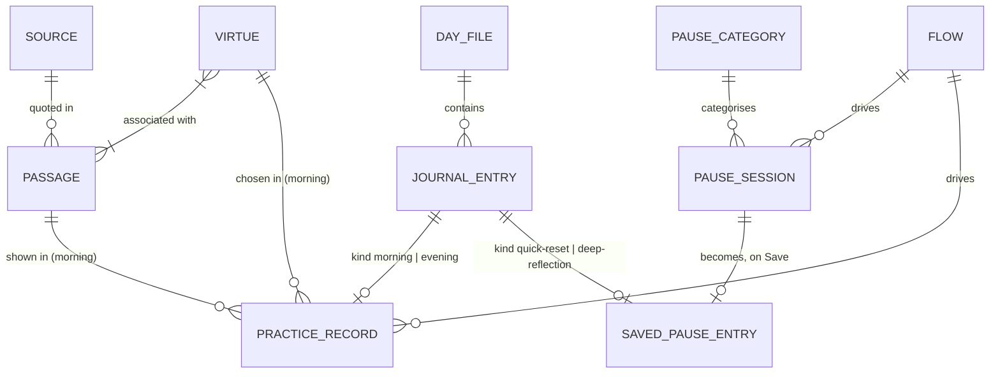

# Data Model: Stoic Companion (Phases 1–2)

**Feature Directory**: `specs/001-stoic-companion` | **Date**: 2026-11-05 | **Spec**: [stoic-companion.spec.md](stoic-companion.spec.md) | **Plan**: [plan.md](plan.md) | **Research**: [research.md](research.md)

The feature is greenfield, so every entity here is new. They fall into four groups. Each group has its own storage and its own owner, and FR-046 keeps them apart:

| Group | Entities | Where it lives | Who writes it |
|---|---|---|---|
| Bundled content | Source, Virtue, Passage, Reminder, Pause Category | `extension/content/*.json`, read-only | Nobody at runtime; curated in the repo |
| Personal data | Day File, Journal Entry (Practice Record, Saved Pause Entry) | `$XDG_DATA_HOME/stoic-companion/days/YYYY-MM-DD.json` | The Shell process only (`lib/store.js`, R7) |
| Configuration | Sidebar Configuration | GSettings `org.gnome.shell.extensions.stoic-companion` | Preferences window and the Shell |
| Runtime only | Pause Session, Meeting Mode, Flow, Today View | Memory | The Shell process; never persisted |



Conventions used throughout:

- **Ids** of bundled content are lowercase kebab-case strings, unique within their file (for example `courage`, `meditations-2-1`). Sorting by id is what makes the daily pick independent of file order (R8).
- **Entry ids** are `GLib.uuid_string_random()` values.
- **Date keys** are local-date strings `YYYY-MM-DD`. The day starts at local midnight.
- **Timestamps** are ISO 8601 local times with offset, for example `2026-11-05T08:14:03+11:00`.
- **Blank answers** are omitted from stored records rather than stored as empty strings. An answer that is all whitespace counts as blank.

---

## 1. Bundled content

Loaded and validated once at `enable()` by `lib/content.js`. `tests/content.test.js` runs the same validation against the shipped files, so a content mistake fails `make test` and never reaches the user. Every rule below is enforced there.

### 1.1 Source (`content/sources.json`)

A published, public-domain translation that passages quote from (FR-058, R12).

| Field | Type | Required | Notes |
|---|---|---|---|
| `id` | string | yes | For example `long-meditations-1862` |
| `author` | string | yes | `Marcus Aurelius`, `Epictetus`, `Seneca` |
| `works` | string[] | yes | Works quoted from this source, with Standard Ebooks titles, for example `["On Anger", "On Providence"]` |
| `translation` | string | yes | Title of the translation as first published |
| `translator` | string | yes | |
| `edition` | string | yes | The Standard Ebooks edition the text is copied from: release year, "spelling modernized", and URL (R12) |
| `year` | integer | yes | Year the translation was first published |
| `publicDomainBasis` | string | yes | Why it is public domain worldwide, for example `Published 1862; translator died 1879` |

**Validation**
- Every field is present and non-empty; `works` has at least one item.
- `publicDomainBasis` must not contain `to be confirmed` or `TBC` in a release build, so no source ships with an unconfirmed basis.

### 1.2 Virtue (`content/virtues.json`)

| Field | Type | Required | Notes |
|---|---|---|---|
| `id` | `"wisdom" \| "courage" \| "justice" \| "temperance"` | yes | |
| `name` | string | yes | Display name, for example `Courage` |
| `definition` | string | yes | One line, shown under Today's Virtue |
| `prompts` | string[] | yes | Used by morning practice and the Deep Reflection virtue step |

**Validation**
- Exactly four virtues with exactly the ids above (spec Assumptions).
- `definition` is a single line (no newline).
- `prompts` has at least one item.
- Every virtue has at least one passage, and at least three by curation target (FR-059, SC-015, R12).

### 1.3 Passage (`content/passages.json`)

A quotation shown as A Thought to Carry and in the morning practice passage step.

| Field | Type | Required | Notes |
|---|---|---|---|
| `id` | string | yes | Unique; for example `meditations-2-1` |
| `kind` | `"quotation"` | yes | Only direct quotations ship in this release (R12). Paraphrase and interpretation labels are Phase 3 (FR-028) |
| `text` | string | yes | The quoted words |
| `sourceId` | string | yes | References a Source |
| `work` | string | yes | One of the Source's `works` |
| `locator` | string | yes | Book, chapter or section, for example `II.1` |
| `virtueIds` | string[] | yes | One or more Virtue ids (FR-059) |
| `explanation` | string | no | Short explanation. Carried in content, not displayed in Phases 1–2 (FR-027 is Phase 3) |

Author, translation, translator, edition and public-domain basis are reached through `sourceId`. A passage therefore records all six attributes FR-058 asks for without repeating them.

**Validation**
- `sourceId` resolves to a Source, and `work` is listed in that Source's `works`.
- `virtueIds` is non-empty, has no duplicates, and every id resolves to a Virtue.
- `text` is non-empty.

### 1.4 Reminder (`content/reminders.json`)

Original modern text written for the product (R12). Two lists in one file.

```json
{ "stoic":   [{ "id": "...", "text": "..." }],
  "meeting": [{ "id": "...", "text": "Listen to understand before responding." }] }
```

| Field | Type | Required | Notes |
|---|---|---|---|
| `id` | string | yes | Unique within its list |
| `text` | string | yes | Concise; one or two sentences |

**Validation**
- Each list has at least one reminder.
- Text passes the tone deny-list (R13, see 1.6).

### 1.5 Pause Category (`content/guidance.json`)

The eight disturbance categories and their guidance (FR-021, FR-022).

| Field | Type | Required | Notes |
|---|---|---|---|
| `id` | string | yes | One of `anger`, `anxiety`, `frustration`, `conflict`, `overwhelm`, `self-criticism`, `disappointment`, `general-disturbance` |
| `label` | string | yes | Display name, for example `General disturbance` |
| `acknowledge` | string | yes | Names the emotion as natural (FR-056) |
| `judgement` | string | yes | Points from the event to the judgement about it |
| `control` | string | yes | What is and is not in the user's control |
| `virtue` | string | yes | Which virtue meets this disturbance, for the Deep Reflection virtues step |
| `responses` | `{id, text}[]` | yes | Suggested deliberate responses offered in the response step |

**Validation**
- Exactly eight categories with exactly the ids above (US2 scenario 2).
- `responses` has at least one item; response ids are unique within a category.

### 1.6 Tone rule across all modern text

Applies to Reminders, Pause Categories, Virtue `prompts`, and the step prompts in `lib/flows.js` (FR-023, FR-056, R13).

- No text contains, case-insensitively, any of: `diagnos`, `disorder`, `therapy`, `treatment`, `you should not feel`, `failure`, `weak`.
- Passing the deny-list is necessary, not sufficient: a person still reviews the wording.

---

## 2. Personal data

Owned by `lib/store.js`. Only the Shell process reads or writes it (R7). Nothing in this group is ever sent anywhere (FR-041) or put in a notification (FR-045).

### 2.1 Storage layout

```text
$XDG_DATA_HOME/stoic-companion/            mode 0700
└── days/                                   mode 0700
    ├── 2026-11-05.json                     mode 0600, one Day File
    └── 2026-11-04.json.unreadable-<ts>     a file that failed to load, set aside (R6)
```

### 2.2 Day File

One JSON document per local date. It is the unit of reading, writing and atomic replacement.

```json
{
  "version": 1,
  "date": "2026-11-05",
  "entries": [ /* Journal Entry, in creation order */ ]
}
```

| Field | Type | Notes |
|---|---|---|
| `version` | integer | `1`. A later version is read-only to this release: shown, never rewritten |
| `date` | date key | Must equal the file name's date |
| `entries` | Journal Entry[] | Appended in creation order; never reordered |

**Validation and integrity**
- Written only with `replace_contents_bytes_async` and `PRIVATE | REPLACE_DESTINATION`, so the file on disk is always either the previous complete version or the new complete version (FR-042, SC-006).
- Writes to one file are serialised; the latest write wins.
- A file that does not parse as JSON, lacks `version`, `date` or `entries`, or whose `date` disagrees with its name is renamed to `YYYY-MM-DD.json.unreadable-<timestamp>` and never overwritten. The user is told once (R6).
- An entry with an unknown `kind` is skipped for display but kept as-is when the file is rewritten, so a newer release's data survives an older one.
- A failed write leaves the old file untouched. The data stays in memory, is retried on the next change, and the user gets one generic notification per session (R6).

### 2.3 Journal Entry (common fields)

A dated, user-owned record (FR-031). There are four kinds. Morning and evening entries are Practice Records (2.4). Quick Reset and Deep Reflection entries are Saved Pause Entries (2.5).

| Field | Type | Required | Notes |
|---|---|---|---|
| `id` | uuid string | yes | Unique across all days |
| `kind` | `"morning" \| "evening" \| "quick-reset" \| "deep-reflection"` | yes | |
| `state` | `"in-progress" \| "completed"` | yes | Saved Pause Entries are always `completed` |
| `createdAt` | timestamp | yes | Its local date equals the Day File's `date` |
| `updatedAt` | timestamp | yes | Last change saved |
| `finishedAt` | timestamp | when `completed` | Moment of Finish or Save |
| `answers` | object | yes | Kind-specific; may be `{}` because every answer is optional (FR-017) |

**Validation**
- `finishedAt` is present if and only if `state` is `completed`.
- `createdAt ≤ updatedAt ≤ finishedAt`.
- `answers` holds only the keys listed for its kind; blank answers are omitted.
- No score, count, streak or rating field exists on any entry or file (FR-018).

### 2.4 Practice Record (`kind`: `morning` | `evening`)

A morning practice or evening reflection for one date (FR-015, FR-016, FR-019).

**Morning `answers`** (five steps, in this order)

| Key | Type | Step | Notes |
|---|---|---|---|
| `virtueId` | Virtue id | Virtue | The virtue chosen for today |
| `challenges` | string | Challenges | Anticipated challenges |
| `inControl` | string | Control | What is in my control |
| `notInControl` | string | Control | What is not |
| `passageId` | Passage id | Passage | The passage shown, recorded when the step is reached. No answer is asked for |
| `intention` | string | Intention | Today's intention |

**Evening `answers`** (four steps)

| Key | Type | Step |
|---|---|---|
| `wentWell` | string | What went well |
| `disturbance` | string | Where I was disturbed |
| `virtueActed` | string | Whether I acted on my virtue |
| `improvement` | string | What to improve |

Today's morning intention is shown in the evening reflection (FR-054). It is read from the morning record, not copied into the evening one.

Both kinds also carry:

| Field | Type | Notes |
|---|---|---|
| `currentStep` | step id | The step the user was last on, so reopening resumes there (US4 scenario 4). Removed when the record is completed |

**Rules**
- A record is created on the first answer or step change, not on opening the dialog. Opening and closing straight away leaves Not started.
- Each answer is saved 500 ms after the last keystroke, and immediately on a step change or close (R5). `disable()` flushes any pending write.
- `state` becomes `completed` only on an explicit Finish (FR-019). Blank answers never block Finish (FR-017).
- Reopening a practice resumes the latest `in-progress` record of that kind for today. If there is none, a new record is started. Starting again after Completed creates a second record; both are kept.
- A morning `virtueId` must resolve to a Virtue, and `passageId` to a Passage associated with that virtue (or with the daily virtue if none was chosen).
- A record belongs to the Day File of its `createdAt` date and is never moved. Once that date has passed it cannot be resumed or finished (spec Edge Cases).

### 2.5 Saved Pause Entry (`kind`: `quick-reset` | `deep-reflection`)

Written exactly once, when the user chooses Save at the end of a Pause Session (FR-025, FR-031). Never edited afterwards. `state` is `completed`, and `createdAt` is the time the session was opened.

**Quick Reset `answers`** (steps: identify, control, response, conclude)

| Key | Type | Notes |
|---|---|---|
| `categoryId` | Pause Category id | |
| `text` | string | Optional free text about the disturbance (FR-021) |
| `responseId` | response id | A suggested response from the category, or |
| `responseText` | string | the user's own response |

**Deep Reflection `answers`** (seven steps: recognise, event, judgement, control, virtues, response, conclude)

| Key | Type | Step |
|---|---|---|
| `categoryId` | Pause Category id | Recognise the disturbance |
| `event` | string | Describe the event |
| `judgement` | string | Separate event from judgement |
| `inControl` | string | What I can control |
| `notInControl` | string | What I cannot |
| `virtueIds` | Virtue id[] | Virtues considered |
| `virtueNotes` | string | How the virtues apply |
| `responseId` | response id | Suggested response, or |
| `responseText` | string | the user's own |

**Validation**
- `categoryId` resolves to a Pause Category; `responseId` resolves to a response of that category; `virtueIds` resolve to Virtues.
- A Pause Session produces at most one Saved Pause Entry (US5 scenario 4).

### 2.6 Delete all personal data

FR-043 and SC-009. Confirmed in a Shell dialog, then in this order: close any open flow and discard its in-memory state, cancel pending writes, delete `$XDG_DATA_HOME/stoic-companion/` recursively (including set-aside `.unreadable-*` files), and rebuild the Today View, which falls back to the daily pick with both indicators Not started. GSettings configuration is not personal data and is left alone.

---

## 3. Sidebar Configuration (GSettings)

Schema `org.gnome.shell.extensions.stoic-companion`, compiled from `extension/schemas/`. It persists across sessions (FR-005, SC-005). Meeting mode is deliberately not here (FR-014). `tests/schema.test.js` checks every default and range below.

| Key | Type | Default | Range / choices | Requirement |
|---|---|---|---|---|
| `sidebar-position` | `s` | `'right'` | `left`, `right` | FR-002 |
| `sidebar-width` | `i` | `270` | 200–480 logical px; at runtime also capped at half the work-area width (R2) | FR-002, Edge Cases |
| `sidebar-hidden` | `b` | `false` | | FR-004, FR-005 |
| `background-opacity` | `d` | `0.94` | 0.5–1.0; applies to the background colour only (R11) | FR-035 |
| `color-scheme` | `s` | `'system'` | `system`, `light`, `dark` | FR-035 |
| `toggle-sidebar` | `as` | `[]` | Accelerator strings | FR-036 |
| `toggle-meeting-mode` | `as` | `[]` | Accelerator strings | FR-036 |
| `open-pause` | `as` | `[]` | Accelerator strings | FR-036 |
| `focus-sidebar` | `as` | `[]` | Accelerator strings | FR-036, FR-047 |
| `morning-reminder-enabled` | `b` | `false` | | FR-037 |
| `morning-reminder-time` | `s` | `'08:00'` | `HH:MM`, 24-hour local | FR-037 |
| `evening-reminder-enabled` | `b` | `false` | | FR-037 |
| `evening-reminder-time` | `s` | `'20:00'` | `HH:MM`, 24-hour local | FR-037 |

**Validation**
- Out-of-range numbers are rejected by the schema's `<range>`; the runtime clamp handles a work area smaller than the stored width.
- A reminder time that does not match `^([01]\d|2[0-3]):[0-5]\d$` is treated as disabled, and the preferences window does not let one be entered.
- Each accelerator must parse with `Gtk.accelerator_parse`; an empty list means unbound. Shortcuts are unbound by default so they never clash with the user's own.
- The noon split for Daily Practice Status (FR-053) is a constant, not a setting.

---

## 4. Runtime-only entities

None of these touch disk.

### 4.1 Meeting Mode

A boolean field on the `Extension` instance. It starts `false` whenever the Shell process starts, survives lock and unlock, and is lost on logout or Shell restart (FR-014, R3, US3 scenario 5). When `true`, the Today View's reminder comes from the `meeting` list; nothing else changes. Turned on only by the user, never by any detection (FR-044, US3 scenario 4).

### 4.2 Flow and Step (`lib/flows.js`)

Code-defined descriptions that the one `FlowDialog` runs (R4).

| Field | Notes |
|---|---|
| `Flow.id` | `morning`, `evening`, `quick-reset`, `deep-reflection` |
| `Flow.persist` | `as-you-go` (practices) or `on-save` (Pause) |
| `Flow.steps` | Ordered Steps |
| `Step.id` | Stored as `currentStep`, for example `virtue`, `control`, `response` |
| `Step.prompt` | Original text; subject to the tone rule (1.6) |
| `Step.fields` | Zero or more Fields. `Field.id` is an answer key above; `Field.input` is `virtue`, `virtues`, `category`, `text`, `response` or `passage` (read only). The full step and field table is in [contracts/lib-api.md](contracts/lib-api.md) |

**Rules**
- Every step is skippable (FR-017, FR-057). Pause flows offer Skip to response from any step before it.
- Practice flows offer Switch to the other practice (FR-053).

### 4.3 Pause Session

An open Quick Reset or Deep Reflection. It lives only in the `FlowDialog`'s memory (FR-025, SC-014).

| Field | Type | Notes |
|---|---|---|
| `flowId` | `quick-reset` \| `deep-reflection` | |
| `openedAt` | timestamp | Becomes `createdAt` if saved |
| `currentStep` | step id | |
| `answers` | object | Same shape as the matching Saved Pause Entry |
| `state` | `open` \| `concluded` \| `saved` \| `discarded` | See 5.2 |

Dropping the dialog drops the session. Nothing is written until Save, and no partial session is ever written.

### 4.4 Today View (`lib/today.js`)

The single derived object the sidebar renders from (plan, call paths). Rebuilt whenever the store, the date or Meeting mode changes. The sidebar never reads files.

| Field | Derivation |
|---|---|
| `dateKey` | `dateKey()` of the wall-clock time |
| `virtue` | `{id, name, definition, chosen}`. `virtueId` of the latest completed morning record today that has one (latest by `finishedAt`), with `chosen: true`; otherwise `dailyVirtue()`, which is `virtues[hash(dateKey) % 4]` with virtues sorted by id (R8) |
| `passage` | `{id, text, author, work, locator}` from `passageFor(dateKey, virtue.id)`: the virtue's passages sorted by id, index `hash(dateKey + ":" + virtueId) % n`, joined with its Source |
| `reminder` | `{id, text, meeting}` from the `stoic` list with key `dateKey + ":reminder"`, or the `meeting` list with key `dateKey + ":meeting"` when Meeting mode is on |
| `morning`, `evening` | `'not-started'`, `'in-progress'` or `'completed'`; see 5.1 |
| `intention` | `intention` of the latest morning record today that has one, for the evening reflection (FR-054) |

Today's saved entries for the read-only entries dialog (FR-054) come from `Store.entries()`, not from this view.

**Invariants**
- The same date and virtue always give the same passage (FR-009). Choosing the daily virtue in morning practice therefore leaves the passage unchanged.
- The view changes only on a date change, a finished morning practice, a Meeting mode toggle or delete-all (FR-013, SC-003). Saving answers to an in-progress practice changes the indicators but not the virtue, passage or reminder.

---

## 5. State transitions

### 5.1 Practice Record and the Morning / Evening indicators

Per record (stored `state`, with Unfinished derived from the date):

```text
(no record) ──first answer or step change──▶ in-progress
in-progress ──close / reopen──────────────▶ in-progress   (resumes at currentStep)
in-progress ──Finish──────────────────────▶ completed     (final)
in-progress ──local midnight──────────────▶ Unfinished    (final; still stored as in-progress on its own date)
```

Unfinished is not written to disk. It is any `in-progress` record whose Day File date is before today, so no write has to happen at midnight. At the date change the store flushes any pending write for the old day. Any later edit to that record is refused, and it is never offered for resume.

Each indicator is derived from today's records of its kind only (FR-012):

| Today's records of that kind | Indicator |
|---|---|
| None | Not started |
| At least one `in-progress`, none `completed` | In progress |
| At least one `completed` | Completed |

There is no percentage, score or carry-over between days (FR-018). At midnight both indicators read the new, empty day and show Not started.

### 5.2 Pause Session

```text
open ──Next / Skip to response, reaching conclude──▶ concluded
open ──Close or Escape────────────────────────────▶ discarded   (final; nothing written)
concluded ──Save───────────────────────────────────▶ saved      (final; exactly one Saved Pause Entry written)
concluded ──Done without Save──────────────────────▶ discarded  (final; nothing written)
```

`saved` and `discarded` are terminal. Save is offered once, so a session can never write a second entry. If the Save write fails, the session stays `concluded` with its answers in memory and the user is told (R6). It is never half-written.

### 5.3 Sidebar visibility

Two independent inputs decide whether the sidebar shows:

| `sidebar-hidden` (user) | Full-screen window in front on the primary monitor | Sidebar |
|---|---|---|
| `false` | no | Shown |
| `false` | yes | Hidden by the Shell (`trackFullscreen`, FR-055) |
| `true` | either | Removed from chrome (`removeChrome`, R2) |

The lock and login screens never show it, because the extension runs only in `user` session mode (FR-007, R3).

### 5.4 Daily reminders

Runtime memory in `ui/reminders.js` holds `lastFired[morning|evening]` as a date key. On each wall-clock minute a reminder fires when its `*-enabled` key is true, the current `HH:MM` equals its `*-time`, that practice is not already Completed today, and `lastFired` is not today. A reminder missed while locked or logged out is not sent later. Notification text is fixed and generic and never contains journal content (FR-045, R9).

---

## 6. Requirement traceability

| Requirement | Where it is modelled |
|---|---|
| FR-002, FR-004, FR-005, FR-035–FR-037 | Sidebar Configuration (3) |
| FR-008, FR-009, FR-010, FR-013 | Today View (4.4) |
| FR-012, FR-053 | Indicators (5.1), Flow (4.2) |
| FR-014 | Meeting Mode (4.1) |
| FR-015–FR-019, FR-054 | Practice Record (2.4), 5.1 |
| FR-020–FR-025, FR-057 | Pause Category (1.5), Pause Session (4.3), Saved Pause Entry (2.5), 5.2 |
| FR-023, FR-056 | Tone rule (1.6) |
| FR-031 | Journal Entry (2.3) |
| FR-039, FR-042 | Storage layout and Day File integrity (2.1, 2.2) |
| FR-043 | Delete all (2.6) |
| FR-045 | Daily reminders (5.4) |
| FR-046 | Group split (top of this document) |
| FR-055, FR-007 | Sidebar visibility (5.3) |
| FR-058, FR-059 | Source (1.1), Virtue (1.2), Passage (1.3) |
